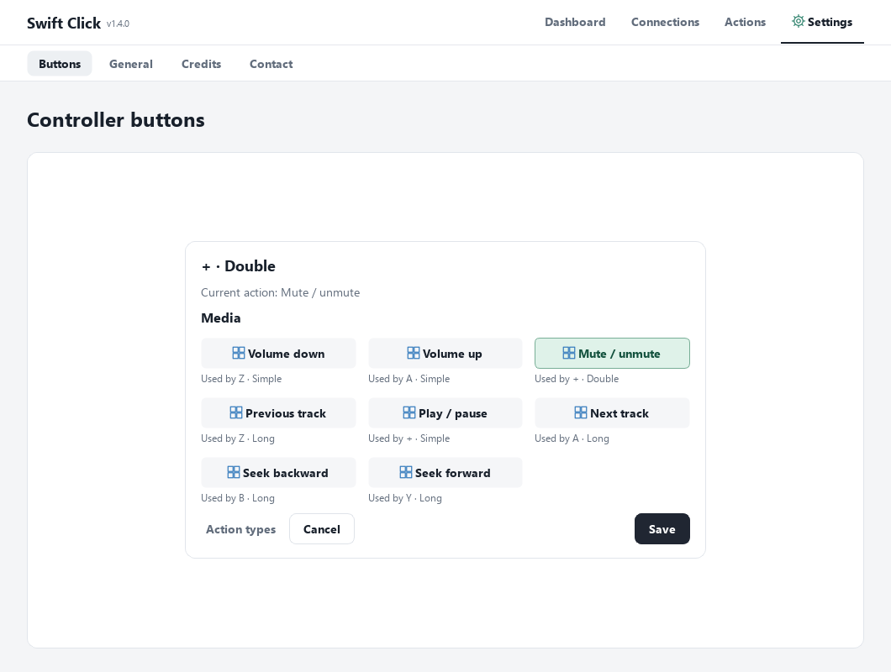
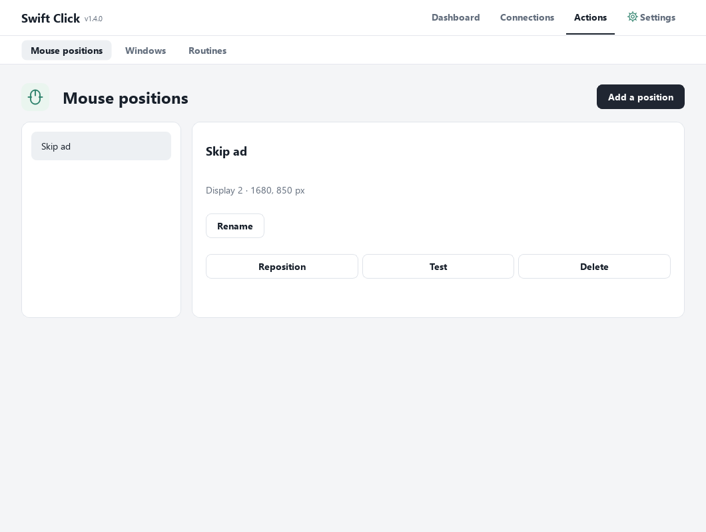
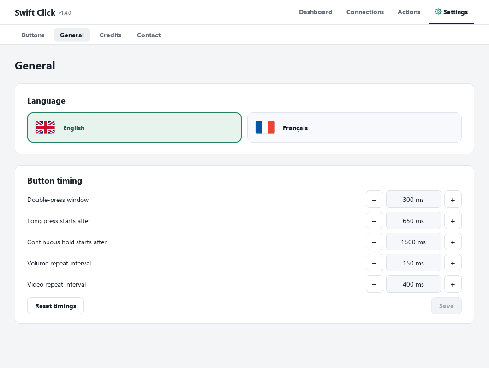

# Swift Click

Use a **Zwift Click V2 right controller with MyWhoosh on Windows**, with media controls and named mouse targets.

[Download 1.4.0 for Windows](https://github.com/benoitzelsmann/swift-click/releases/download/v1.4.0/SwiftClick-1.4.0-Setup.exe) · [Release notes](https://github.com/benoitzelsmann/swift-click/releases/tag/v1.4.0) · [Report an issue](https://github.com/benoitzelsmann/swift-click/issues) · [Installation](docs/INSTALLATION.md) · [Compatibility](docs/COMPATIBILITY.md) · [Privacy](docs/PRIVACY.md)

## Why Swift Click exists

Many smart trainers are sold with Zwift Cog and Click hardware, including [Zwift Ready bundles](https://support.zwift.com/en_us/zwift-ready-and-zwift-cog-compatible-trainers-r1x1sNas0). You may already own the controller but prefer not to pay for a recurring Zwift subscription. That was my starting point: I wanted to use the hardware I had bought without another subscription just to change gears.

[MyWhoosh is free to ride](https://www.mywhoosh.com/docs/is-there-a-membership-fee-to-use-mywhoosh/), but my Click V2 did not pair directly with it for shifting. Swift Click fills that gap: it receives presses from the right-hand controller over Bluetooth and sends gear commands to MyWhoosh through OpenBikeControl. The same buttons can control music or a video while riding.

**Only the right-hand Zwift Click V2 is supported** — the controller marked **Y, A, B, Z and +**. The left-hand arrow controller, the original Click V1, Zwift Play and Zwift Ride controls are not supported by this release.

## How this compares with BikeControl

BikeControl is an established alternative and a useful reference for the OpenBikeControl protocol. Swift Click focuses on this particular right-controller-to-MyWhoosh setup and local Windows controls.

According to [BikeControl's official pricing page](https://bikecontrol.app/pricing/), checked on **5 November 2026**:

- **Base** is a one-time purchase of about **US$4.99 per platform**, with unlimited button actions, including shifting handled by the training app.
- **Pro** is about **US$2.50/month**, or **US$2.25/month billed annually**, and adds BikeControl's own virtual shifting and other features. Store prices vary by region.
- After its initial trial, the unpurchased app allows **15 button actions per day**. The separate Pro virtual-shifting trial allows **20 minutes per day**.

Base already removes the daily button-action limit. Pro is not required simply to exceed 20 gear changes per day. Swift Click's current beta has no purchase, subscription or daily shift counter.

## What it does

- Change gears in MyWhoosh using the OpenBikeControl network protocol.
- Enable Simple, Double, Long and Continuous hold independently on each button.
- Control Windows volume, mute/unmute, play/pause and previous/next tracks.
- Target a selected video window for left/right navigation, or MyWhoosh for its own arrow keys.
- Save named windows, with automatic MyWhoosh/media detection.
- Build visual routines with open, activate, minimize, close, switch, click, seek and wait actions.
- Click at the current pointer position or at named points saved on your displays.
- Switch between English and French with the flag buttons under **Settings → General**, without restarting connections.
- View credits, third-party license notices and feedback links under **Settings → Credits / Contact**.

No browser extension, Swift Click account or telemetry is required. Video controls activate the selected window and require keyboard focus inside its player. If Windows refuses activation, no key is sent. Named clicks require the target window to remain in the saved position.

The controller screenshot shows the maintainer's saved button configuration. The other screenshots use illustrative examples. New installations start with no actions assigned.

## Visual routines

Prepare **Mouse positions** and **Windows** under Actions, then open **Routines**.
Drag an action into the diagram, select its saved targets and choose **Confirm action**.
Reorder the numbered cards by dragging or with the arrow buttons. Save the routine
and assign **Run routine** to a Simple, Double or Long press under Settings → Buttons.

For example, **Skip ad and return** displays your video window, clicks the named
Skip ad point and returns to the window that was active before the routine.
The point must still match a visible, clickable button. This does not detect ads
automatically. A final **Switch** stays in the new window instead of returning.

The catalogue clearly marks the selected routine. Selecting one does not run it;
use **Test**, **Stop**, or the controller gesture you assigned.

Windows actions can make a button perform a complete sequence: display the video
window, click a saved point, then return to MyWhoosh. Open, activate, minimize and
normal close steps work with named windows; Switch alternates between two targets.
Clicks remain tied to physical screen positions, so reposition a target when its
window moves. Windows activation is verified before targeted input is sent.

[Read the full windows, clicks and routines guide](docs/ACTIONS.md).

## Media and saved targets

The **Media** category groups volume, mute/unmute, playback, tracks and video seeking.
MyWhoosh and Windows icons identify where commands go. Continuous hold supports
repeated volume/video commands; mute is a single toggle per gesture.

## Language and gesture settings

Settings is at the right of the navigation bar. Choose English or French under
**General**, where you can edit the double-press window, Long/Hold thresholds and
volume/video repeat intervals. Choose **Save** to apply them, or **Reset timings**
to restore the default values. Each press keeps the timings captured when it began.
**Manage presses** on the
Buttons page enables or disables each gesture without discarding its assignment.

## Download and install

Open **Releases** and download the file ending in **Setup.exe**, not GitHub's automatic source ZIP. Run the installer, then open Swift Click from the Start menu. Python is included. Windows 11 x64 and Bluetooth are required.

The 1.4.0 package is a public unsigned Windows beta. Windows security settings may warn about or block it. Check the release notes and SHA-256 checksum. Full ride endurance testing and installation on clean PCs remain in progress. macOS is not available yet.

Upgrading from 1.0 preserves mappings, named positions, language and connections, with a configuration backup. Double starts disabled. Updates are downloaded and installed manually. There is no automatic updater in this release.

## Controller setup

Wake the right controller and connect it in Swift Click. Start the MyWhoosh connection and accept it in MyWhoosh. The app includes illustrated connection guides. If MyWhoosh displays **Dircon Service Unavailable**, choose **YES**, complete installation, then **close and restart MyWhoosh** before connecting. Configure assignments in Settings → Buttons. Actions groups Mouse positions, Windows and Routines, in preparation order.

The Dashboard includes Open MyWhoosh alongside its connection states. It opens the installed game or brings its existing window forward; it does not establish the network connection. Routine results stay in Actions. The routine catalogue opens a separate editor for creation and modification, using prepared windows and positions. App icons help identify the selected windows.

Under **Settings → Buttons → Manage presses**, enable the gestures you need. With default timings, Simple triggers on release; when Double is enabled it waits up to 300 ms for a second brief press. Long triggers on release from 650 ms. Continuous hold starts at 1.5 seconds, repeating volume every 150 ms or video arrows every 400 ms. MyWhoosh arrows remain down until release. Gestures are exclusive, and disabled gestures keep their saved actions.

Under **Actions → Windows**, save named windows and choose the MyWhoosh and Media defaults. Detection reads Windows media sessions and preserves existing selections. Window handles are not persisted; after restart, ambiguous targets require selection again. **Actions → Routines** builds a visual top-to-bottom sequence from these windows and saved positions. See the [clicks and routines guide](docs/ACTIONS.md) for examples and behaviour. Targeted clicks verify that the point is inside the selected window and not covered. Keyboard arrow behaviour for MyWhoosh junctions has not been verified; no route-selection guarantee is made.

An optional experimental keep-awake mode is limited to the tested right controller firmware 1.2.0. It uses the controller's firmware-update mechanism and can erase its secondary firmware slot. Activation requires the explanation and consent shown in the app. Long-session validation is still pending.

## What is in this repository

This is the public distribution and issue-tracking repository. The `ui/` directory contains the Python/PySide6 interface sources. The Bluetooth engine, system-control implementation and build history are kept private.

These UI modules depend on the private application services and cannot run as a standalone application. Use the Windows installer to run Swift Click. Publication of the UI files does not grant an open-source license. Third-party libraries and visual assets retain their respective rights and licenses. Dependency notices are included with the installed app.

Swift Click is an independent project maintained by [benoitzelsmann](https://github.com/benoitzelsmann). It is not affiliated with or endorsed by Zwift or MyWhoosh. Product names and logos belong to their respective owners.

## Feedback and credits

Use [GitHub Issues](https://github.com/benoitzelsmann/swift-click/issues) for bug reports and suggestions, or open **Settings → Contact** in the app. A dedicated email address will be added when available. Please remove personal details from screenshots and logs.

**Settings → Credits** lists the author, protocol references and main libraries, with access to the third-party notices included in the installer. The interface language is saved locally and can be changed between English and French at any time.
