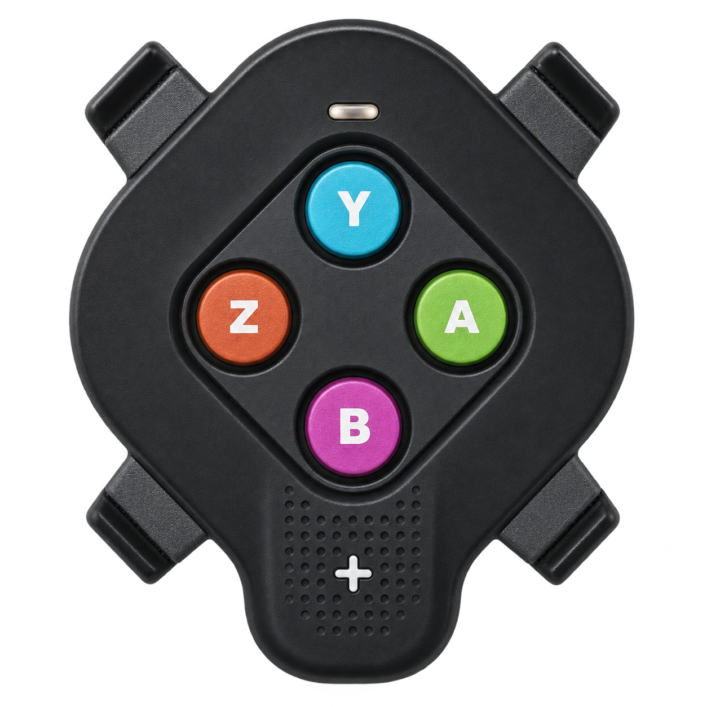

# Swift Click

Use a **Zwift Click V2 right controller with MyWhoosh on Windows**, with media controls and named mouse targets.

[Downloads and release notes](https://github.com/benoitzelsmann/swift-click/releases) · [Report an issue](https://github.com/benoitzelsmann/swift-click/issues) · [Compatibility](docs/COMPATIBILITY.md) · [Installation](docs/INSTALLATION.md) · [Privacy](docs/PRIVACY.md)

## Why Swift Click exists

Many smart trainers are sold with Zwift Cog and Click hardware, including [Zwift Ready bundles](https://support.zwift.com/en_us/zwift-ready-and-zwift-cog-compatible-trainers-r1x1sNas0). You may already own the controller but prefer not to pay for a recurring Zwift subscription. That was my starting point: I wanted to use the hardware I had bought without another subscription just to change gears.

[MyWhoosh is free to ride](https://www.mywhoosh.com/docs/is-there-a-membership-fee-to-use-mywhoosh/), but my Click V2 did not pair directly with it for shifting. Swift Click fills that gap: it receives presses from the right-hand controller over Bluetooth and sends gear commands to MyWhoosh through OpenBikeControl. The same buttons can control music or a video while riding.

**Only the right-hand Zwift Click V2 is supported** — the controller marked **Y, A, B, Z and +**. The left-hand arrow controller, the original Click V1, Zwift Play and Zwift Ride controls are not supported by this release.

## How this compares with BikeControl

BikeControl is an established alternative and a useful reference for the OpenBikeControl protocol. Swift Click focuses on this particular right-controller-to-MyWhoosh setup and local Windows controls.

According to [BikeControl's official pricing page](https://bikecontrol.app/pricing/), checked on **4 November 2026**:

- **Base** is a one-time purchase of about **US$4.99 per platform**, with unlimited button actions, including shifting handled by the training app.
- **Pro** is about **US$2.50/month**, or **US$2.25/month billed annually**, and adds BikeControl's own virtual shifting and other features. Store prices vary by region.
- After its initial trial, the unpurchased app allows **15 button actions per day**. The separate Pro virtual-shifting trial allows **20 minutes per day**.

Base already removes the daily button-action limit. Pro is not required simply to exceed 20 gear changes per day. Swift Click's current beta has no purchase, subscription or daily shift counter.

## What it does

- Change gears in MyWhoosh using the OpenBikeControl network protocol.
- Assign short presses, long presses and holds to the five controller buttons.
- Control Windows volume, play/pause and previous/next tracks.
- Send left/right arrow presses to the active video player.
- Click at the current pointer position or at named points saved on your displays.
- Switch between English and French with the flag buttons under **Settings → General**, without restarting connections.
- View credits, third-party license notices and feedback links under **Settings → Credits / Contact**.

No browser extension, Swift Click account or telemetry is required. Browser video controls depend on the active player and its keyboard focus. Named clicks require the target window to remain in the saved position.

## Download and install

Open **Releases** and download the file ending in **Setup.exe**, not GitHub's automatic source ZIP. Run the installer, then open Swift Click from the Start menu. Python is included. Windows 11 x64 and Bluetooth are required.

The 1.0.0 package is an unsigned release candidate. Windows security settings may warn about or block it. Check the release notes and SHA-256 checksum. Full ride endurance testing and installation on clean PCs remain in progress. macOS is not available yet.

Updates use the same installer and preserve settings, except for the one-time 0.15 button-mapping reset described in the installation guide. Updates are downloaded and installed manually. There is no automatic updater in this release.

## Controller setup

Wake the right controller and connect it in Swift Click. Start the MyWhoosh connection and accept it in MyWhoosh. The app includes illustrated connection guides. Configure button assignments and mouse targets in Settings.

Short presses trigger on release before 650 ms. Long presses trigger on release after 650 ms. A configured hold starts at 1.5 seconds and repeats volume or video navigation until release. The three gestures are exclusive.

An optional experimental keep-awake mode is limited to the tested right controller firmware 1.2.0. It uses the controller's firmware-update mechanism and can erase its secondary firmware slot. Activation requires the explanation and consent shown in the app. Long-session validation is still pending.

## What is in this repository

This is the public distribution and issue-tracking repository. The `ui/` directory contains the Python/PySide6 interface sources. The Bluetooth engine, system-control implementation and build history are kept private.

These UI modules depend on the private application services and cannot run as a standalone application. Use the Windows installer to run Swift Click. Publication of the UI files does not grant an open-source license. Third-party libraries and visual assets retain their respective rights and licenses. Dependency notices are included with the installed app.

Swift Click is an independent project maintained by [benoitzelsmann](https://github.com/benoitzelsmann). It is not affiliated with or endorsed by Zwift or MyWhoosh. Product names and logos belong to their respective owners.

## Feedback and credits

Use [GitHub Issues](https://github.com/benoitzelsmann/swift-click/issues) for bug reports and suggestions, or open **Settings → Contact** in the app. A dedicated email address will be added when available. Please remove personal details from screenshots and logs.

**Settings → Credits** lists the author, protocol references and main libraries, with access to the third-party notices included in the installer. The interface language is saved locally and can be changed between English and French at any time.
