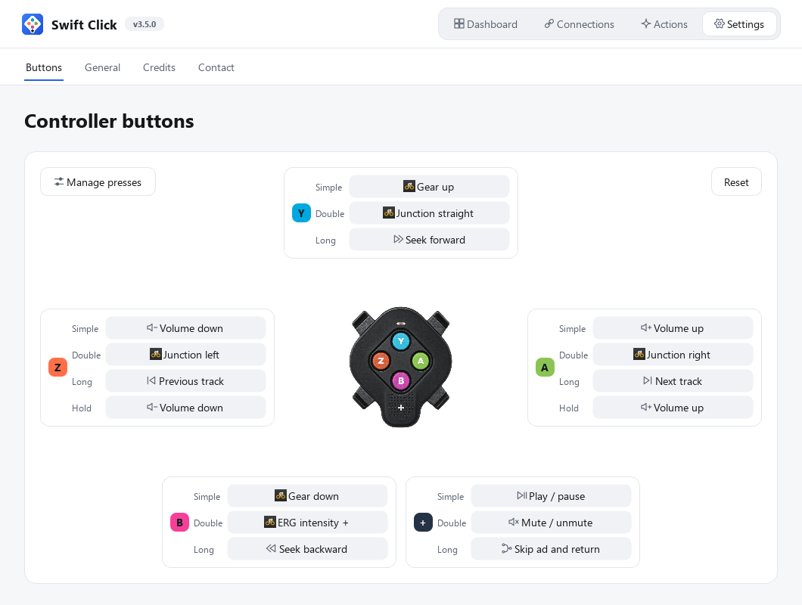
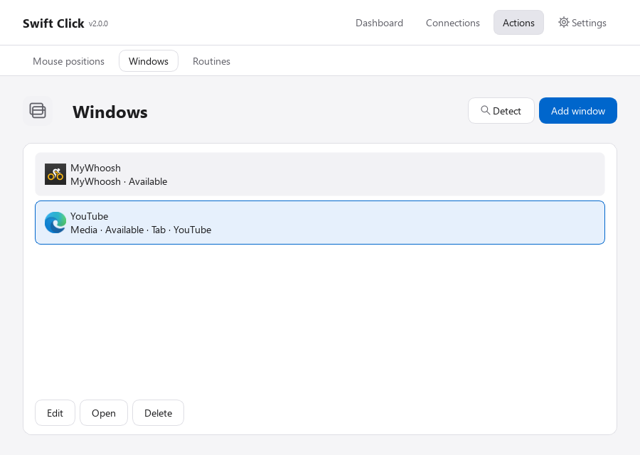
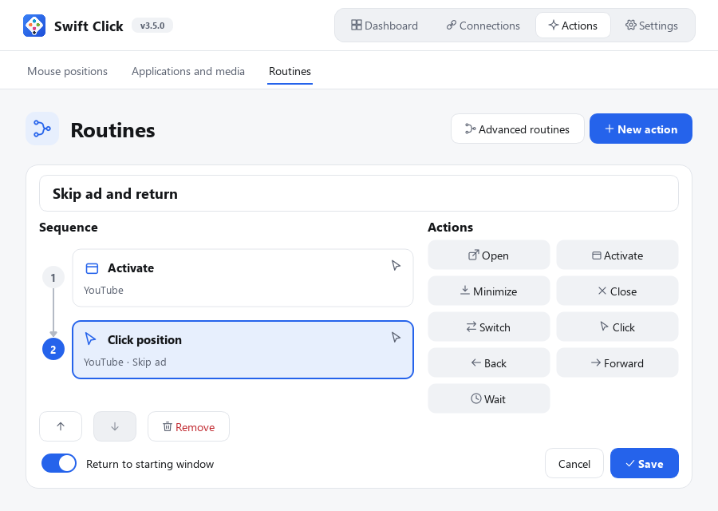
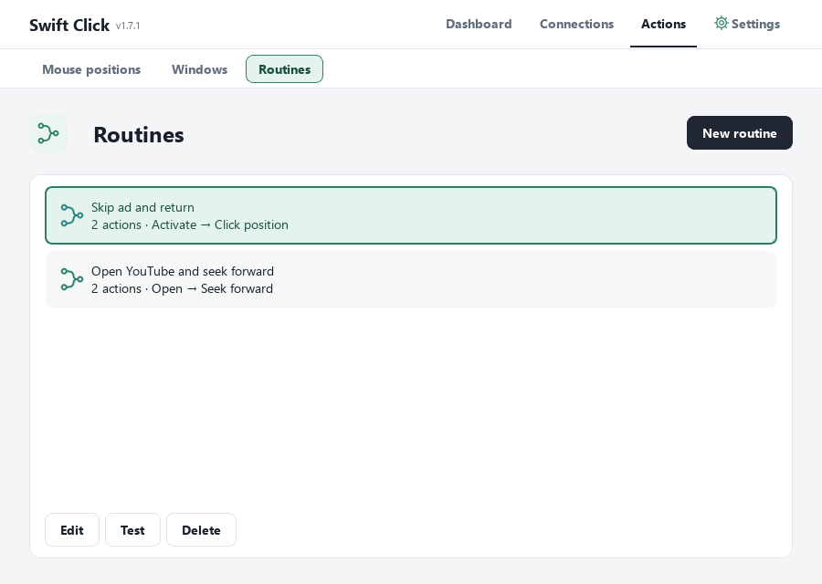

# Swift Click

Ride **MyWhoosh on Windows with a Zwift Click V2 right controller**. Swift Click turns its five buttons into gear changes, lateral moves, junction choices, media controls, mouse clicks and complete routines, so you never have to leave the saddle to reach the keyboard or the mouse.

[Download for Windows](https://github.com/benoitzelsmann/swift-click/releases/latest) · [Report an issue](https://github.com/benoitzelsmann/swift-click/issues) · [Installation](docs/INSTALLATION.md) · [Compatibility](docs/COMPATIBILITY.md) · [Privacy](docs/PRIVACY.md)

## Why Swift Click

Many smart trainers ship with Zwift Cog and Click hardware. [MyWhoosh is free to ride](https://www.mywhoosh.com/docs/is-there-a-membership-fee-to-use-mywhoosh/), but the Click V2 does not pair with it for shifting. Swift Click bridges the two: it reads the controller over Bluetooth and talks to MyWhoosh on your local network through the OpenBikeControl protocol. No account, subscription, daily limit or telemetry.

**Supported controller:** the right-hand Zwift Click V2 (buttons **Y, A, B, Z, +**). The left-hand controller, Click V1, Zwift Play and Zwift Ride are not supported.

## How it works

1. **Connect** the controller and MyWhoosh once, on the **Connections** page.
2. **Assign** an action to each gesture of each button, under **Settings → Buttons**.
3. **Ride.** Swift Click runs in the background and sends each action the moment you press.

The **Dashboard** shows both connections at a glance, the last command sent, and buttons to start the session or open MyWhoosh.

## Buttons and gestures

Each of the five buttons recognises four gestures, so up to twenty actions fit on one small controller:

| Gesture | When it fires | Typical use |
|---|---|---|
| **Simple** | On release of a short press | Gear up / down |
| **Double** | Two presses within 300 ms | Junction choice, skip an ad |
| **Long** | Press held past 650 ms | Next / previous track |
| **Hold** | Held past 1.5 s, repeats while held | Volume, lateral move, video seek |

Only **Simple** is active by default, so each press reacts instantly. Choose **Manage presses** on the Buttons page: a check box appears next to every gesture, tick the ones you want, then choose **Done**. Timings are adjustable under **Settings → General**.

To assign an action, click the gesture's slot on the diagram and pick a category (**MyWhoosh**, **Media**, **Mouse** or **Routines**), then the action.

## MyWhoosh

| Action | What it does |
|---|---|
| **Gear up / Gear down** | Shifts through MyWhoosh's virtual gears, sent over the network, so MyWhoosh doesn't need to be in front. |
| **Move left / Move right** | Moves your rider across the road for as long as you hold, using OpenBikeControl *Steer* commands. A keyboard fallback (A / D) is available under **Settings → General → Advanced controls**. |
| **Junction left / straight / right** | Chooses your road when MyWhoosh shows its direction tiles. |

**Junctions in detail.** MyWhoosh offers no keyboard shortcut or network command for choosing a direction: you normally have to click one of the two or three tiles it shows, and their position changes with their number. When you press a junction gesture, Swift Click looks at a small band of the MyWhoosh window, finds the tile whose arrow points the way you asked, clicks it and puts the pointer back. If that direction isn't offered, nothing is clicked. The image is analysed in memory on your PC and never saved or sent.

**A link that holds for the whole ride.** Both sides exchange keep-alive messages; after sleep, a Wi-Fi drop or an IP change, Swift Click reconnects on its own. Commands that couldn't be delivered during a reconnection are dropped rather than replayed late, so you never get a surprise shift.

## Media

Control what plays next to MyWhoosh without touching the keyboard:

- **Volume up / down** (repeats while held) and **Mute / unmute**.
- **Play / pause**, **Previous track**, **Next track** — work with Spotify, Deezer, YouTube, Netflix and any player that reports to Windows' media controls.
- **Seek backward / forward** — jumps in the video of the window you set as your media target, a few seconds per press or continuously while held.

## Mouse clicks

- **Left click** clicks wherever the pointer currently is.
- **Click saved position** clicks a point you captured earlier (for example a *Skip ad* button), then returns the pointer where it was.

To save a point, open **Actions → Mouse positions**, name it and choose **Capture position**: Swift Click hides for three seconds while you place the pointer. It records the window under the point, and refuses to click if that window isn't in front or the point is covered, so a click never lands in the wrong place.

## Applications and media targets

Save the programs and websites you want to reach under **Actions → Applications and media**: MyWhoosh, any application, or a website (YouTube, Netflix, Deezer or your own address). Websites are matched by address, so a new video title doesn't break them, and the right tab is selected in Edge or Chrome. **Detect** finds MyWhoosh and the media players already open. Swift Click never minimizes or moves MyWhoosh.

## Routines

A routine chains several steps behind a single gesture. Build it visually under **Actions → Routines**: drag steps into the sequence, pick their target, reorder them with the mouse, then **Test** before saving.

| Step | What it does |
|---|---|
| **Open** | Starts a saved application or website, or brings it forward if it's already open |
| **Activate** | Brings an open window or tab to the front |
| **Switch** | Alternates between two windows or two tabs on each press |
| **Click position** | Clicks a saved point inside its window, after checking it's visible |
| **Seek backward / forward** | Jumps in a video |
| **Minimize / Close window** | Tidies a window away (never MyWhoosh) |
| **Wait** | Pauses 0.1 to 10 seconds between steps |

Example, *Skip ad and return*: show YouTube, click the saved *Skip* position, return to MyWhoosh. Assign it under **Settings → Buttons → Routines**: the routine list opens directly. If you switch windows yourself while a routine runs, it stops instead of pulling focus back.

More detail in the [windows, clicks and routines guide](docs/ACTIONS.md).

## Settings

- **Appearance**: light, dark or follow Windows.
- **Language**: English or French.
- **Gesture timings**: double-press window, long-press and hold thresholds, repeat speed for volume and video.
- **Advanced controls**: lateral moves over the network (default) or with the A / D keys.
- **Settings backup**: export everything to one local file and restore it later; a recovery copy is kept before every restore.
- **Updates**: checked only when you ask.
- **Contact**: report a problem or suggest an improvement; *Copy technical details* adds versions and connection states without any personal data.

## Install

1. Download the file ending in **Setup.exe** from [Releases](https://github.com/benoitzelsmann/swift-click/releases/latest) and run it. Python is included.
2. In **Connections**, wake the controller and choose **Connect**.
3. Choose **Connect** for MyWhoosh, then in MyWhoosh click the **OpenBikeControl** handlebar icon and accept with **YES**.
4. Assign your buttons under **Settings → Buttons**.

Requires Windows 10 22H2 or Windows 11 (x64) with Bluetooth, and MyWhoosh on the same PC or local network. The installer is unsigned: Windows may warn before running it. Check the SHA-256 checksum in the release notes. Upgrading keeps your settings.

## Good to know

- **Keep awake** is an optional, experimental mode for controller firmware 1.2.0. It uses the firmware-update mechanism and asks for your consent first.
- **Everything stays local.** Settings, positions and logs live in your Windows account; nothing is uploaded.

## Compared with BikeControl

[BikeControl](https://bikecontrol.app/) supports many controllers and apps and is a useful OpenBikeControl reference. Swift Click focuses on one setup — right Click V2, MyWhoosh, Windows — and is free with no daily action limit. See [BikeControl's pricing](https://bikecontrol.app/pricing/) for its current plans.

## This repository

Public distribution and issue tracking. `ui/` holds the PySide6 interface sources; the Bluetooth engine and system controls are private, so these files don't run on their own — use the installer. Publishing the UI sources doesn't grant an open-source license.

Swift Click is an independent project by [benoitzelsmann](https://github.com/benoitzelsmann), not affiliated with Zwift or MyWhoosh. Product names and logos belong to their owners. Feedback: [GitHub Issues](https://github.com/benoitzelsmann/swift-click/issues) or **Settings → Contact** in the app.
