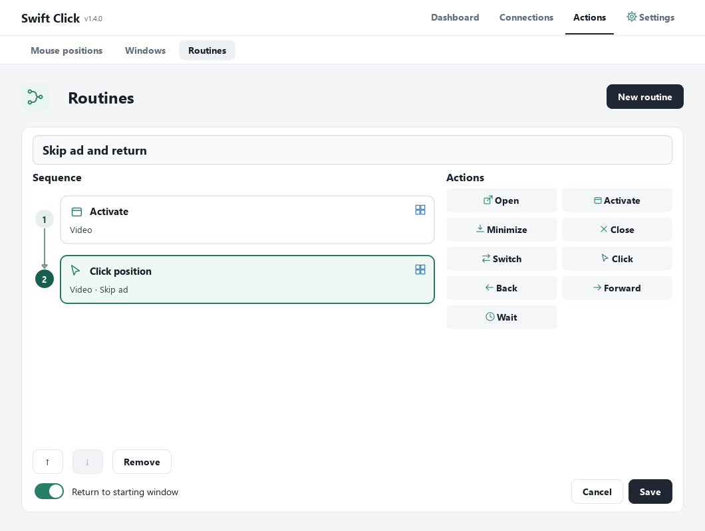
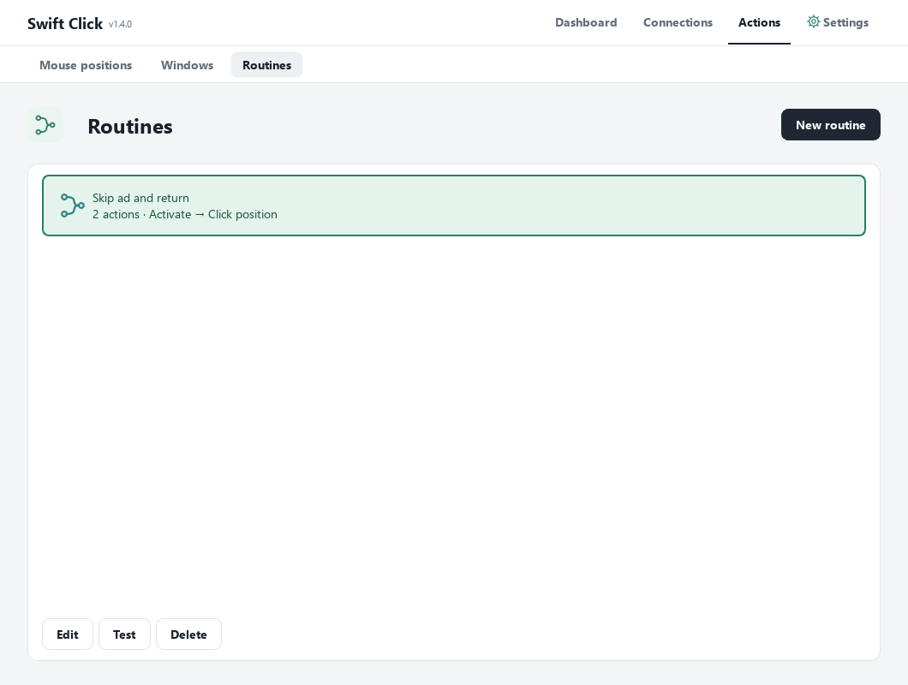
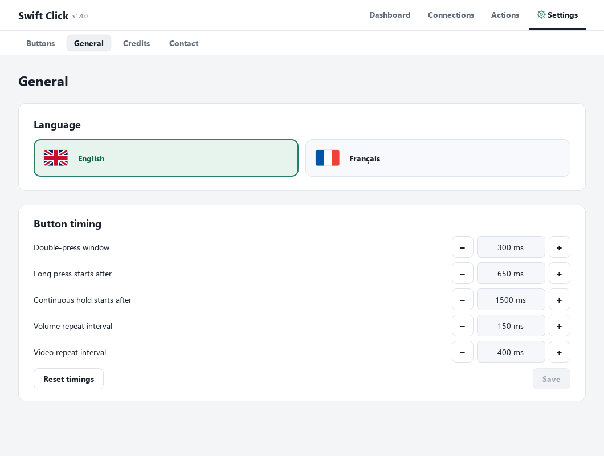
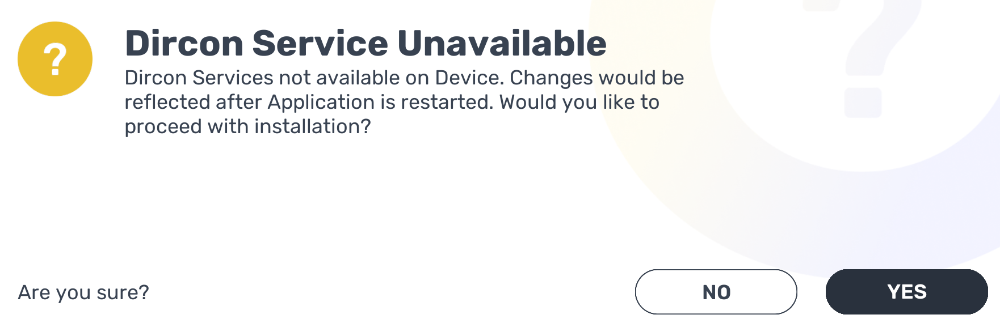

# Windows, mouse clicks and routines

## Prepare your targets

1. In **Actions → Mouse positions**, give a point a name and choose Capture position.
   Swift Click hides for three seconds. Place the pointer on the target; capture
   records it without clicking. Reposition it after moving the target window or
   changing a display's resolution/scaling.
2. In **Actions → Windows**, add and name any open application window. **Detect**
   looks for MyWhoosh and media sessions reported by Windows. It fills unconfigured
   defaults only when a single target is found. Otherwise select the window yourself.
3. Assign the MyWhoosh and Media defaults for direct arrow commands. Other saved windows can be
   used by routines. If several windows of the same app cannot be distinguished
   after a restart, select the intended one again.

## Choose a click

| Choice | Behaviour |
| --- | --- |
| Left click | One click at the current pointer, without selecting a window |
| Click saved position | Move to the point, click once and restore the pointer |
| Routine: Click position | Activate the selected window, verify the point is inside it and uncovered, then click once |

The pointer is not restored if you move the mouse yourself during the operation.
Restoring it does not restore keyboard focus. A routine's **Return to starting
window** option handles focus separately. Missing/changed displays block saved clicks.
Clicks do not detect a YouTube ad: the saved point must still correspond to the
visible **Skip / Ignorer** button. Test the position with the video visible first.

## Build a routine

Choose **New routine**, name it and add actions. Each action becomes a card in a
top-to-bottom diagram. Choose its saved target, then **Confirm action**. Reorder cards
by dragging or using the arrows. **Confirm action** returns directly to the action
choices. Click a numbered card to edit it again. **Save** commits the whole routine; **Cancel**
leaves the saved version unchanged. A routine supports up to 32 actions.

You can also drag an action from the choices into the sequence. A line shows the
insertion point; configure the action and confirm to insert it there. Drag existing
cards to reorder them, or use the bordered Up, Down and Remove controls below.

- **Open** starts the saved application if needed, or displays its existing window.
  Restoring a specific document or browser tab depends on the application.
- **Activate** displays an already open window.
- **Minimize / Close window** affect that window. Close is a normal close request;
  unsaved-document confirmations remain in control of the application.
- **Switch** alternates between two saved windows. From another app, it displays
  the first target. A final Switch stays in the new window; automatic return is
  unavailable because it would immediately undo the switch. Existing switch
  routines follow this same rule.
- **Click position** activates its window and checks the saved point before clicking.
- **Seek backward / forward** activates its window and sends a complete left/right
  key press. The video player needs keyboard focus inside the browser.
- **Wait** pauses between actions for 0.1–10 seconds.

Example: **Click position · Edge / Ignorer YouTube → Activate · MyWhoosh**.
Alternatively, a single click step with **Return to starting window** returns to
whichever app was active before the routine.
When testing from Swift Click, the starting window is Swift Click itself. With a
controller button during a ride, it is the window active at that moment.

After saving, use **Test** and **Stop**, then assign **Run routine** under
**Settings → Buttons**. Routines run once on Simple, Double or Long; they cannot
be repeated with Continuous hold. A new window action cancels the preceding
sequence. Disconnecting or closing Swift Click discards pending actions. If you
switch windows manually, the routine stops instead of pulling focus back.

## Keep the controller simple

Enable only the gestures you need in **Manage presses**. Simple reacts on release.
The following durations are defaults; edit them under **Settings → General**.
Double adds up to 300 ms of waiting to Simple. Long reacts on release after 650 ms.
Continuous hold begins at 1.5 seconds and excludes the other gestures. Without
Long, an earlier release remains Simple; without Long or Hold, a prolonged press
also remains Simple. Disabled gestures retain their assignments.

Continuous hold allows only volume, video arrows and MyWhoosh arrows. Volume and
video repeat; MyWhoosh arrows remain down until release. Gears use OpenBikeControl
and do not depend on the foreground window.

Media also includes **Mute / unmute**, which toggles Windows output mute once.
Assign it to Simple, Double or Long; it is excluded from Continuous hold. Gesture
timing details are displayed under **Settings → General**. The old direct Switch
windows shortcut is no longer offered; add a Switch step to a named routine instead.

## Adjustable durations

Use **Settings → General → Button timing** to change the following values and
choose **Save**. **Reset timings** fills in the defaults; save to confirm the reset.

| Setting | Default | Range |
| --- | --- | --- |
| Double-press window | 300 ms | 100–600 ms |
| Long press starts after | 650 ms | 200–2,000 ms |
| Continuous hold starts after | 1,500 ms | 500–5,000 ms |
| Volume repeat interval | 150 ms | 80–500 ms |
| Video repeat interval | 400 ms | 150–2,000 ms |

Hold must begin at least 100 ms after Long. The editor maintains this ordering.
An in-progress press or double retains its timing snapshot; new presses use the
saved settings. Timings do not change which actions support Continuous hold.

## MyWhoosh service setup

On the pairing screen, select the OpenBikeControl handlebar icon. If **Dircon
Service Unavailable** appears, choose **YES** and finish installing the service.
Allow Bonjour installation if requested. **Close and restart MyWhoosh afterwards**,
then connect Swift Click and accept **OpenBikeControl Instance Found** with YES.

The app contains the same illustrated guide under **Connections → MyWhoosh**.
